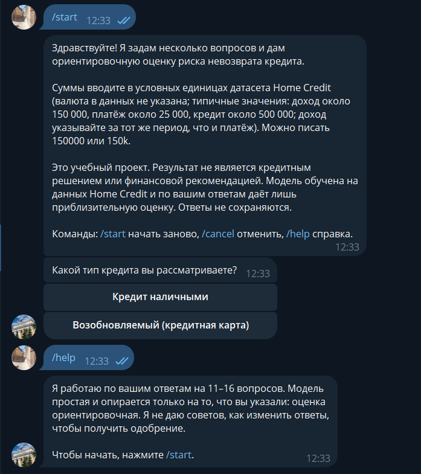
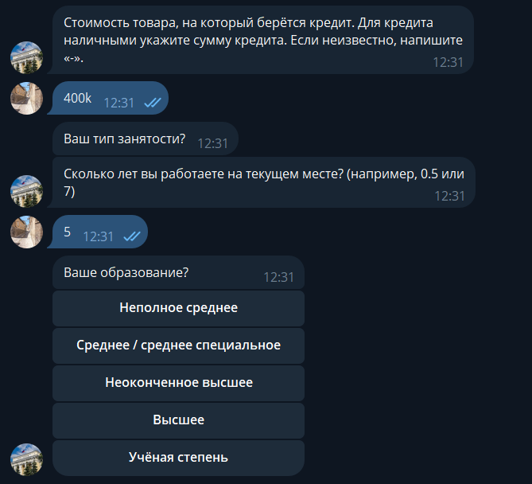
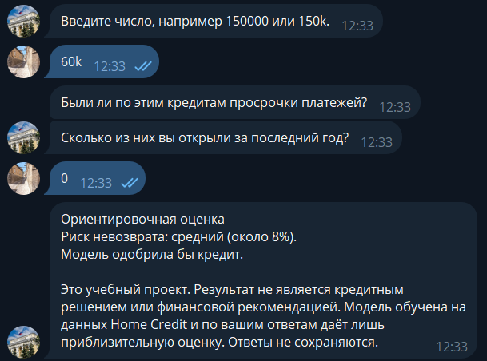

# Кредитный скоринг: от данных Home Credit до Telegram-бота

Учебный проект по анализу данных. По данным [Home Credit Default Risk](https://www.kaggle.com/c/home-credit-default-risk)
строится модель вероятности дефолта заёмщика, объясняются причины отказа, а результат доступен через Telegram-бота.
Проект не является кредитным решением или финансовой рекомендацией.

<p align="center">
  
  
  
</p>

## Коротко

- **Данные:** 4 из 7 таблиц соревнования (заявки, кредитное бюро, прошлые заявки, платежи по рассрочкам), 307 тысяч заявок,
  дефолт у 8%.
- **Модель:** LightGBM, ROC AUC 0.786 на отложенной выборке (20% клиентов, не использовалась при подборе), Gini 0.57.
  Вероятности откалиброваны без отдельного калибратора.
- **Объяснения:** SHAP, признаки сгруппированы в понятные причины отказа. В модели только признаки, которые можно назвать
  клиенту (пол, семейное положение, возраст и регион исключены), цена этого принципа 0.004 AUC.
- **Бот:** упрощённая модель на 11 – 16 вопросах (AUC 0.718): категория риска, решение, причины отказа, проверка диапазонов
  ответов, тесты, Docker.

## Быстрый старт

### Запуск бота (данные не нужны)

Требуется Python 3.11 или новее (проверено на 3.12). Модели и конфигурация лежат в `models/`.

```bash
git clone <URL репозитория> && cd <папка репозитория>
python -m venv .venv && source .venv/bin/activate     # Windows: .venv\Scripts\activate
pip install -r requirements-bot.txt
cp .env.example .env                                   # вставьте токен от @BotFather
python -m bot.main
```

1. Токен выдаёт @BotFather в Telegram (команда `/newbot`). В `.env` строка выглядит так: `TELEGRAM_BOT_TOKEN=<токен>`,
   без кавычек. Файл `.env` нельзя коммитить, токен нельзя публиковать.
2. Модель сохранена через `joblib`, поэтому версии `lightgbm`, `scikit-learn`, `pandas` и `numpy` должны совпадать с теми,
   в которых она обучалась (см. комментарий в `requirements-bot.txt`).
3. Без Telegram бота можно проверить в консоли: `python -m bot.cli` (тот же диалог и та же модель).
4. Тесты: `python -m pytest tests -q`.

**Docker** (из корня репозитория):

```bash
docker build -t credit-bot .
docker run -d --name credit-bot --restart unless-stopped --env-file .env credit-bot
docker logs -f credit-bot
```

В файле для `--env-file` токен пишется без кавычек. Для одного токена должен работать один экземпляр бота: при втором
Telegram вернёт ошибку `Conflict: terminated by other getUpdates request`.

**Если бот не стартует с `ConnectTimeout`:** проверьте `curl -v -m 15 https://api.telegram.org` (и с ключами `-4`, `-6`).
Если работает только IPv4, отключите IPv6 в системе или добавьте в `.env` строку `TELEGRAM_FORCE_IPV4=1`. Если Telegram
недоступен напрямую, задайте прокси: `TELEGRAM_PROXY=http://127.0.0.1:8080`.

### Воспроизведение исследования (нужны данные)

```bash
pip install -r requirements-research.txt
# примите правила соревнования на странице Kaggle, затем (нужен API-токен Kaggle в ~/.kaggle/kaggle.json):
kaggle competitions download -c home-credit-default-risk -p data/raw
unzip data/raw/home-credit-default-risk.zip -d data/raw
```

Нужны четыре файла в `data/raw/`: `application_train.csv`, `bureau.csv`, `previous_application.csv`,
`installments_payments.csv`. Данные соревнования в репозиторий не входят. Ноутбуки запускаются по порядку из папки
`notebooks/` (пути вида `../data/raw`); зерно везде 42, список клиентов отложенной выборки сохраняется в
`data/processed/holdout_ids.csv`.

| Ноутбуки | Содержание |
|---|---|
| 01 – 02 | EDA, очистка данных, доменные признаки, baseline |
| 03 – 04 | Агрегаты из `bureau`, `previous_application`, `installments_payments` |
| 05 – 06 | Отложенная выборка, сравнение моделей, подбор гиперпараметров (Optuna) |
| 07 – 09 | SHAP, причины отказа, роль защищённых признаков, модель из объяснимых признаков |
| 10 – 11 | Дисбаланс классов, калибровка, порог по стоимости ошибок, финальная оценка |
| 12 – 15 | Модель для бота: набор вопросов, монотонность, диапазоны входов |

## Результаты

**Качество на отложенной выборке** (61 502 клиента; ROC AUC с 95% доверительным интервалом по bootstrap):

| Модель | ROC AUC | Gini | PR AUC | KS |
|---|---|---|---|---|
| **LightGBM, объяснимые признаки (финальная)** | **0.7860** [0.7794; 0.7926] | 0.5720 | 0.2837 | 0.4332 |
| LightGBM, все признаки | 0.7903 [0.7837; 0.7962] | 0.5805 | 0.2892 | 0.4428 |
| Логистическая регрессия, объяснимые признаки | 0.7686 [0.7613; 0.7751] | 0.5372 | 0.2541 | 0.4067 |
| Модель бота (11 – 16 вопросов) | 0.7178 [0.7102; 0.7251] | 0.4356 | 0.1994 | 0.3157 |

**Откуда взялось качество** (5-кратная кросс-валидация на всём train, ROC AUC):

| Набор признаков | Логрегрессия | LightGBM |
|---|---|---|
| Основная таблица (очистка, доменные признаки) | 0.7504 | 0.7655 |
| + `bureau`, `previous_application` | 0.7630 | 0.7805 |
| + `installments_payments` | 0.7711 | **0.7864** |

**Решение о выдаче** (стоимость ошибок R = 5, то есть выдача будущему неплательщику в 5 раз дороже отказа добросовестному
клиенту; R это допущение). Порог отказа 1/(1+R) = 0.167: отказывают 12.4% клиентов и отсеивают 43.8% будущих дефолтов,
доля дефолтов среди одобренных 5.2% против 8.1% в целом.

## Подход и ключевые выводы

1. **Качество дали признаки, а не подбор параметров.** Агрегаты из связанных таблиц добавили около 0.021 AUC, подбор
   гиперпараметров только 0.003. LightGBM лучше логрегрессии на 0.014 и случайного леса на 0.02 (лес при этом в 6 раз медленнее).
2. **Калибровка не понадобилась, балансировка навредила.** Вероятности LightGBM откалиброваны сразу (ECE 0.002 на отложенной
   выборке). Веса классов и undersampling ухудшили ранжирование и сломали вероятности (средний прогноз 37% и 21% вместо 8%).
3. **Порог выведен из стоимости ошибок.** Для откалиброванных вероятностей теоретический оптимум 1/(1+R) оказался близок к
   найденному перебором при всех R от 3 до 10 (расхождение не больше 0.02).
4. **Причины отказа.** Вклады SHAP суммируются по смысловым группам признаков («просрочки по прошлым кредитам» вместо десятков
   коррелированных признаков). Принцип «в модели только то, что можно назвать клиенту» стоит 0.004 AUC.
5. **Справедливость.** Пол восстанавливается по остальным признакам с AUC 0.887 (профессия, организация, автомобиль). Без
   пола модель теряет калибровку по полу: женщинам риск завышается на 0.3 п.п., мужчинам занижается на 0.8 п.п. Это компромисс,
   который описан, а не скрыт.
6. **Проверка поведения бота нашла дефект.** «Что если» показало, что при росте суммы кредита риск падал. Исправлено
   монотонными ограничениями и отказом от абсолютных сумм ценой 0.0017 AUC, подтверждено на сценариях.
7. **Надёжность бота.** Тест на совпадение признаков бота и обучения на реальных строках, предупреждения при ответах вне
   диапазона данных, отказ оценивать редкие типы занятости, обработка ошибок и тесты диалога.

## Ограничения

- Данные одной компании за прошлый период и только одобренные заявки: оценка отражает историческую политику выдачи, а не
  платёжеспособность человека. Например, низкий риск пенсионеров в модели это закономерность выборки.
- Пол и возраст исключены из модели, но косвенные признаки (профессия, автомобиль, тип занятости «Пенсионер») несут часть
  информации о них, поэтому равенство исходов по полу не гарантируется.
- Бот использует упрощённую модель (AUC 0.72 против 0.79): ответы человека лишь приближают реальные агрегаты бюро, так что
  оценка ориентировочная. Он не даёт советов, как получить одобрение: найденные моделью зависимости не причинные.
- Период и единицы дохода в данных не документированы; формулировки вопросов опираются на распределение значений.
- Данные Kaggle в репозиторий не входят; из-за условий их использования демо на реальных клиентах не делалось.
- Отложенная выборка использована для финальной оценки модели; модель бота оценивалась на ней как отчёт, а набор вопросов
  выбирался по обучающей части.

**Что можно улучшить:** остальные три таблицы (`credit_card_balance`, `POS_CASH_balance`, `bureau_balance`), скоркарта на
WoE, мониторинг дрейфа данных, метрики равных шансов по полу.

## Структура репозитория

```
bot/                  Telegram-бот: диалог, предсказатель, запуск, консольная версия
src/                  признаки, модели, метрики, причины отказа, подбор параметров
notebooks/            исследование, ноутбуки 01 – 15 по порядку запуска
models/               модели и конфигурация бота
tests/                тесты бота (диалог, обработчики, признаки, диапазоны)
docs/                 журнал экспериментов (experiments.md), скриншоты
data/                 данные Kaggle (не в репозитории)
requirements-bot.txt  зависимости бота
requirements-research.txt  зависимости ноутбуков
Dockerfile            образ бота
```

Подробный журнал экспериментов, где по каждому шагу есть цифры, проверки и принятые решения:
[docs/experiments.md](docs/experiments.md).
